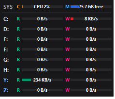

# disk_mini (HDD Monitor)

Windows용 초소형 디스크 I/O 모니터입니다. 화면 한쪽에 항상 떠 있는 작은 창에서
드라이브별 읽기/쓰기 속도와 CPU 사용률, 가용 메모리를 실시간으로 보여줍니다.



## 기능

- **드라이브별 읽기(R) / 쓰기(W) 속도**: 0.5초 간격 갱신, 속도에 따라 막대 스케일 자동 조정
- **로컬 + 네트워크 드라이브 지원**
  - 로컬/이동식 드라이브: `LogicalDisk` 성능 카운터
  - 네트워크 드라이브(파란색 표시): `SMB Client Shares` 카운터, 쓰기가 집계되지 않는 서버(Samba 등)는 `Redirector` 카운터로 보완
  - 관리자 권한으로 실행해도 `HKCU\Network`의 영구 매핑을 읽어 네트워크 드라이브 표시
- **CPU 사용률 / 가용 메모리** (SYS 행)
- 드라이브 추가/제거(USB, 네트워크 드라이브 연결 등) 자동 감지
- 타이틀바 없는 창, 작업 표시줄에 표시되지 않음, 드래그로 이동
- 항상 위(Always on top) 토글: 우클릭 메뉴 또는 트레이 아이콘 메뉴
- 한국어 로케일 성능 카운터 이름 대응

## 사용법

| 동작 | 방법 |
|---|---|
| 창 이동 | 마우스 왼쪽 버튼으로 드래그 |
| 메뉴 | 창에서 우클릭 (Always on top / 종료) |
| 트레이 | 트레이 아이콘 우클릭 (Always on top / Exit) |

### 디버그 모드

```
disk_mini.exe --debug
```

콘솔 창이 열리며 드라이브 인식 과정과 SMB 카운터 값을 출력합니다.

- 디버그 로그: `%TEMP%\disk_mini_debug.log`
- 오류 로그: `%TEMP%\disk_mini_error.log`

## 소스에서 실행

Python 3와 Windows가 필요합니다.

```
pip install pillow pystray
python disk_mini.py
```

## 빌드 (exe)

```
pip install pyinstaller
python -m PyInstaller --clean --noconfirm disk_mini.spec
```

`dist\disk_mini.exe` 단일 실행 파일이 생성됩니다. spec 파일은 사용하지 않는 표준 라이브러리,
PIL 플러그인, Tcl/Tk 데이터를 제외해 실행 파일 크기를 줄이도록 구성되어 있습니다.
